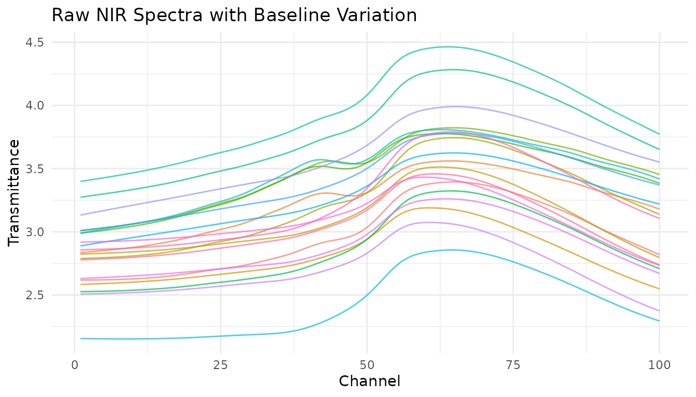
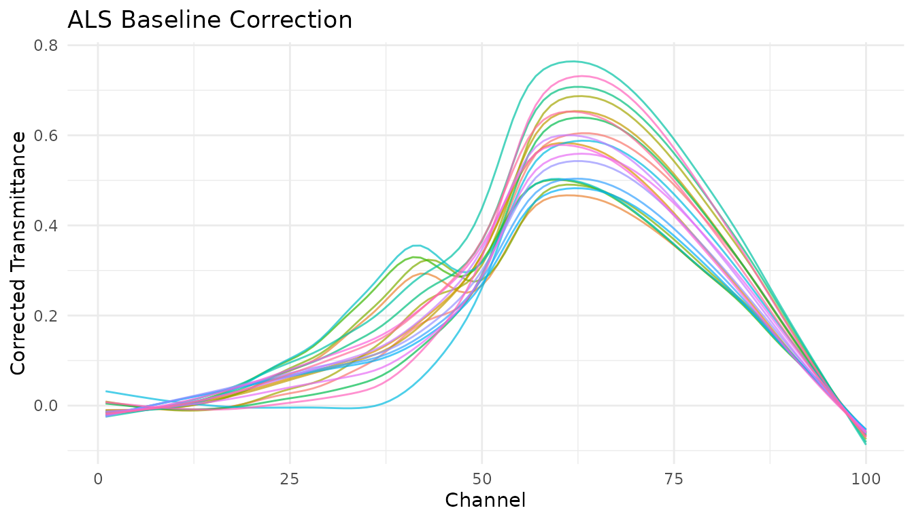
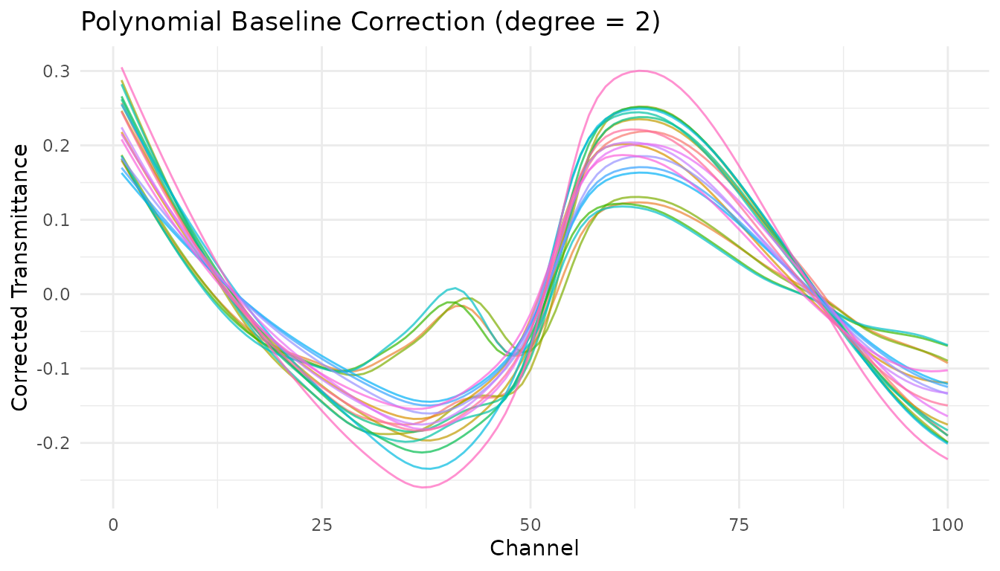

# How-To: Baseline Correction

``` r

library(measure)
library(recipes)
library(dplyr)
library(tidyr)
library(ggplot2)
library(modeldata)

has_pybaselines <- if (requireNamespace("reticulate", quietly = TRUE)) {
  isTRUE(tryCatch(
    reticulate::py_module_available("pybaselines"),
    error = function(e) FALSE
  ))
} else {
  FALSE
}
```

``` r

if (!has_pybaselines) {
  message("Skipping optional pybaselines example (not available in selected Python).")
}
#> Skipping optional pybaselines example (not available in selected Python).
```

## Introduction

Baseline correction is a fundamental preprocessing step for
spectroscopic and chromatographic data. Baselines can drift due to
instrument effects, sample scattering, fluorescence, or detector
response, obscuring the chemical information in your measurements.

The measure package provides several baseline correction methods as
recipe steps, plus the ability to use custom R functions or Python’s
pybaselines library.

## The problem: Baseline drift

Let’s visualize baseline issues in NIR spectra:

``` r

data(meats)

# Convert to long format for visualization
meats_viz <- meats |>
  mutate(id = row_number()) |>
  pivot_longer(
    cols = starts_with("x_"),
    names_to = "channel",
    values_to = "transmittance"
  ) |>
  mutate(channel = as.integer(gsub("x_", "", channel)))

# Plot raw spectra
meats_viz |>
  filter(id <= 20) |>
  ggplot(aes(x = channel, y = transmittance, group = id, color = factor(id))) +
  geom_line(alpha = 0.7) +
  labs(
    x = "Channel",
    y = "Transmittance",
    title = "Raw NIR Spectra with Baseline Variation"
  ) +
  theme_minimal() +
  theme(legend.position = "none")
```



Notice the vertical offset between spectra? This baseline shift isn’t
related to the chemical composition we want to model.

## Built-in baseline correction methods

### Asymmetric Least Squares (ALS)

[`step_measure_baseline_als()`](https://jameshwade.github.io/measure/dev/reference/step_measure_baseline_als.md)
uses the Asymmetric Least Squares algorithm, which is excellent for
spectra where peaks are predominantly in one direction (e.g., absorption
peaks going up or emission peaks going down).

``` r

rec_als <- recipe(water + fat + protein ~ ., data = meats) |>
  step_measure_input_wide(starts_with("x_")) |>
  step_measure_baseline_als(lambda = 1e6, p = 0.01)

processed_als <- bake(prep(rec_als), new_data = NULL)

# Visualize using unnest
plot_als <- processed_als |>
  slice(1:20) |>
  mutate(id = row_number()) |>
  unnest(.measures)

ggplot(plot_als, aes(x = location, y = value, group = id, color = factor(id))) +
  geom_line(alpha = 0.7) +
  labs(
    x = "Channel",
    y = "Corrected Transmittance",
    title = "ALS Baseline Correction"
  ) +
  theme_minimal() +
  theme(legend.position = "none")
```



**Key parameters:**

- `lambda`: Smoothness penalty (higher = smoother baseline). Try 10^4 to
  10^9.
- `p`: Asymmetry parameter (0-1). Lower values fit below the signal. Try
  0.001-0.1.

### Polynomial baseline

[`step_measure_baseline_poly()`](https://jameshwade.github.io/measure/dev/reference/step_measure_baseline_poly.md)
fits a polynomial to the spectrum and subtracts it. Simple and fast,
works well for gentle baseline curvature.

``` r

rec_poly <- recipe(water + fat + protein ~ ., data = meats) |>
  step_measure_input_wide(starts_with("x_")) |>
  step_measure_baseline_poly(degree = 2)

processed_poly <- bake(prep(rec_poly), new_data = NULL)

# Visualize using unnest
plot_poly <- processed_poly |>
  slice(1:20) |>
  mutate(id = row_number()) |>
  unnest(.measures)

ggplot(plot_poly, aes(x = location, y = value, group = id, color = factor(id))) +
  geom_line(alpha = 0.7) +
  labs(
    x = "Channel",
    y = "Corrected Transmittance",
    title = "Polynomial Baseline Correction (degree = 2)"
  ) +
  theme_minimal() +
  theme(legend.position = "none")
```



### Robust fitting baseline

[`step_measure_baseline_rf()`](https://jameshwade.github.io/measure/dev/reference/step_measure_baseline_rf.md)
uses robust local regression (LOESS with iterative reweighting) to
estimate the baseline. Good for complex baseline shapes.

``` r

rec_rf <- recipe(water + fat + protein ~ ., data = meats) |>
  step_measure_input_wide(starts_with("x_")) |>
  step_measure_baseline_rf(span = 0.5) |>
  step_measure_output_wide(prefix = "nir_")

processed_rf <- bake(prep(rec_rf), new_data = NULL)
#> Warning: Values from `value` are not uniquely identified; output will contain list-cols.
#> • Use `values_fn = list` to suppress this warning.
#> • Use `values_fn = {summary_fun}` to summarise duplicates.
#> • Use the following dplyr code to identify duplicates.
#>   {data} |>
#>   dplyr::summarise(n = dplyr::n(), .by = c(water, fat, protein, location)) |>
#>   dplyr::filter(n > 1L)
```

### Detrending

[`step_measure_detrend()`](https://jameshwade.github.io/measure/dev/reference/step_measure_detrend.md)
removes polynomial trends from spectra. The simplest baseline
correction - just removes the overall trend.

``` r

rec_detrend <- recipe(water + fat + protein ~ ., data = meats) |>
  step_measure_input_wide(starts_with("x_")) |>
  step_measure_detrend(degree = 1) |>
  step_measure_output_wide(prefix = "nir_")

processed_detrend <- bake(prep(rec_detrend), new_data = NULL)
#> Warning: Values from `value` are not uniquely identified; output will contain list-cols.
#> • Use `values_fn = list` to suppress this warning.
#> • Use `values_fn = {summary_fun}` to summarise duplicates.
#> • Use the following dplyr code to identify duplicates.
#>   {data} |>
#>   dplyr::summarise(n = dplyr::n(), .by = c(water, fat, protein, location)) |>
#>   dplyr::filter(n > 1L)
```

### GPC/SEC baseline correction

The core
[`step_measure_baseline_gpc()`](https://jameshwade.github.io/measure/dev/reference/step_measure_baseline_gpc.md)
has been superseded. For SEC/GPC data, use
`measure.sec::step_sec_baseline()`, which is maintained in the companion
package. The synthetic example runs when `measure.sec` is installed; it
is skipped with a message otherwise.

``` r

sec_data <- tibble::tibble(
  sample_id = rep(1:3, each = 20),
  concentration = rep(c(10, 25, 50), each = 20),
  time = rep(seq(0, 19), 3),
  signal = rep(
    seq(0.1, 0.2, length.out = 20) +
      c(0, 0, 0, 0, 1, 2, 3, 2, 1, 0.3, rep(0, 10)),
    3
  ) + rep(c(0, 0.1, 0.2), each = 20)
)

if (requireNamespace("measure.sec", quietly = TRUE)) {
  sec_fit <- recipe(concentration ~ ., data = sec_data) |>
    update_role(sample_id, new_role = "id") |>
    step_measure_input_long(
      signal,
      location = vars(time),
      col_name = "ri"
    ) |>
    measure.sec::step_sec_baseline(
      measures = "ri",
      left_frac = 0.1,
      right_frac = 0.1
    ) |>
    prep()

  bake(sec_fit, new_data = NULL) |>
    dplyr::select(sample_id, concentration)
} else {
  message("SEC example skipped: install the optional measure.sec package.")
}
#> SEC example skipped: install the optional measure.sec package.
```

## Custom baseline functions

[`step_measure_baseline_custom()`](https://jameshwade.github.io/measure/dev/reference/step_measure_baseline_custom.md)
lets you provide any R function for baseline estimation. Your function
receives a `measure_tbl` (tibble with `location` and `value` columns)
and should return a numeric vector of baseline values.

### Using a function

``` r

# Simple moving minimum baseline
moving_min_baseline <- function(x, window = 51) {
  y <- x$value
  n <- length(y)
  baseline <- numeric(n)
  half_win <- window %/% 2


  for (i in seq_len(n)) {
    start <- max(1, i - half_win)
    end <- min(n, i + half_win)
    baseline[i] <- min(y[start:end], na.rm = TRUE)
  }
  baseline
}

rec_custom <- recipe(water + fat + protein ~ ., data = meats) |>
  step_measure_input_wide(starts_with("x_")) |>
  step_measure_baseline_custom(.fn = moving_min_baseline, window = 101) |>
  step_measure_output_wide(prefix = "nir_")

processed_custom <- bake(prep(rec_custom), new_data = NULL)
#> Warning: Values from `value` are not uniquely identified; output will contain list-cols.
#> • Use `values_fn = list` to suppress this warning.
#> • Use `values_fn = {summary_fun}` to summarise duplicates.
#> • Use the following dplyr code to identify duplicates.
#>   {data} |>
#>   dplyr::summarise(n = dplyr::n(), .by = c(water, fat, protein, location)) |>
#>   dplyr::filter(n > 1L)
```

### Using a formula

For quick one-liners, use the formula interface where `.x` is the
`measure_tbl`:

``` r

# LOESS baseline using formula
rec_loess <- recipe(water + fat + protein ~ ., data = meats) |>
  step_measure_input_wide(starts_with("x_")) |>
  step_measure_baseline_custom(
    .fn = ~ stats::loess(.x$value ~ .x$location, span = span)$fitted,
    span = 0.3
  ) |>
  step_measure_output_wide(prefix = "nir_")

processed_loess <- bake(prep(rec_loess), new_data = NULL)
#> Warning: Values from `value` are not uniquely identified; output will contain list-cols.
#> • Use `values_fn = list` to suppress this warning.
#> • Use `values_fn = {summary_fun}` to summarise duplicates.
#> • Use the following dplyr code to identify duplicates.
#>   {data} |>
#>   dplyr::summarise(n = dplyr::n(), .by = c(water, fat, protein, location)) |>
#>   dplyr::filter(n > 1L)
```

### Extracting the baseline

With
[`step_measure_baseline_custom()`](https://jameshwade.github.io/measure/dev/reference/step_measure_baseline_custom.md)
and
[`step_measure_baseline_py()`](https://jameshwade.github.io/measure/dev/reference/step_measure_baseline_py.md),
set `subtract = FALSE` to get the baseline itself instead of the
corrected signal:

``` r

# Use custom baseline with subtract = FALSE to extract the baseline
rec_extract <- recipe(water + fat + protein ~ ., data = meats) |>
  step_measure_input_wide(starts_with("x_")) |>
  step_measure_baseline_custom(
    .fn = ~ stats::loess(.x$value ~ .x$location, span = 0.5)$fitted,
    subtract = FALSE
  )

baselines <- bake(prep(rec_extract), new_data = NULL)

# The .measures column now contains the estimated baselines
baselines |>
  slice(1) |>
  unnest(.measures) |>
  head()
#> # A tibble: 6 × 5
#>   water   fat protein location value
#>   <dbl> <dbl>   <dbl>    <dbl> <dbl>
#> 1  60.5  22.5    16.7        1  2.62
#> 2  60.5  22.5    16.7        2  2.62
#> 3  60.5  22.5    16.7        3  2.62
#> 4  60.5  22.5    16.7        4  2.62
#> 5  60.5  22.5    16.7        5  2.62
#> 6  60.5  22.5    16.7        6  2.62
```

## Python pybaselines integration

[`step_measure_baseline_py()`](https://jameshwade.github.io/measure/dev/reference/step_measure_baseline_py.md)
provides access to over 50 baseline correction algorithms from the
Python [pybaselines](https://pybaselines.readthedocs.io/) library.

### Setup

First, make reticulate available in R and declare pybaselines for the
Python environment used by reticulate. These commands are for you to run
when you want to use the backend. The availability check initializes the
selected Python runtime; reticulate may create a managed environment
according to its configuration. measure preserves an explicitly selected
interpreter:

``` r

if (!requireNamespace("reticulate", quietly = TRUE)) {
  install.packages("reticulate")
}
reticulate::py_require("pybaselines")
```

### Using pybaselines methods

``` r

py_small <- meats[1:5, ]
rec_py <- recipe(water + fat + protein ~ ., data = py_small) |>
  step_measure_input_wide(starts_with("x_")) |>
  step_measure_baseline_py(method = "asls", lam = 1e6, p = 0.01) |>
  step_measure_output_wide(prefix = "nir_")

py_fit <- prep(rec_py)
py_processed <- bake(py_fit, new_data = NULL)
py_processed[, 1:6]
```

### Available pybaselines methods

| Category       | Methods                                               |
|----------------|-------------------------------------------------------|
| Whittaker      | `asls`, `iasls`, `airpls`, `arpls`, `drpls`, `psalsa` |
| Polynomial     | `poly`, `modpoly`, `imodpoly`, `loess`, `quant_reg`   |
| Morphological  | `mor`, `imor`, `rolling_ball`, `tophat`               |
| Spline         | `pspline_asls`, `pspline_airpls`, `mixture_model`     |
| Smooth         | `snip`, `swima`, `noise_median`                       |
| Classification | `dietrich`, `golotvin`, `fastchrom`                   |

See the [pybaselines documentation](https://pybaselines.readthedocs.io/)
for the full list and parameter details.

## Using derivatives for baseline correction

Savitzky-Golay derivatives remain a powerful approach for baseline
correction, especially in NIR spectroscopy:

``` r

# First derivative removes constant baseline
rec_d1 <- recipe(water + fat + protein ~ ., data = meats) |>
  step_measure_input_wide(starts_with("x_")) |>
  step_measure_savitzky_golay(window_side = 7, differentiation_order = 1) |>
  step_measure_output_wide(prefix = "nir_")

# Second derivative removes linear baseline
rec_d2 <- recipe(water + fat + protein ~ ., data = meats) |>
  step_measure_input_wide(starts_with("x_")) |>
  step_measure_savitzky_golay(window_side = 7, differentiation_order = 2) |>
  step_measure_output_wide(prefix = "nir_")
```

## Choosing a method

| Method | Best for | Tunable | Notes |
|----|----|----|----|
| [`step_measure_baseline_als()`](https://jameshwade.github.io/measure/dev/reference/step_measure_baseline_als.md) | Most spectroscopy | Yes | Good general-purpose choice |
| [`step_measure_baseline_poly()`](https://jameshwade.github.io/measure/dev/reference/step_measure_baseline_poly.md) | Gentle curvature | Yes | Simple and fast |
| [`step_measure_baseline_rf()`](https://jameshwade.github.io/measure/dev/reference/step_measure_baseline_rf.md) | Complex baselines | Yes | Robust to outliers |
| [`step_measure_detrend()`](https://jameshwade.github.io/measure/dev/reference/step_measure_detrend.md) | Simple trends | Yes | Fastest option |
| `measure.sec::step_sec_baseline()` | SEC/GPC chromatography | No | Companion package |
| [`step_measure_baseline_custom()`](https://jameshwade.github.io/measure/dev/reference/step_measure_baseline_custom.md) | Special cases | Optional | Maximum flexibility |
| [`step_measure_baseline_py()`](https://jameshwade.github.io/measure/dev/reference/step_measure_baseline_py.md) | Advanced algorithms | Yes | 50+ methods available |
| [`step_measure_savitzky_golay()`](https://jameshwade.github.io/measure/dev/reference/step_measure_savitzky_golay.md) | NIR/IR spectra | Yes | Also smooths and differentiates |

## Hyperparameter tuning

Most baseline correction steps are tunable with the tidymodels tuning
framework:

``` r

rec_tunable <- recipe(water ~ ., data = meats) |>
  step_measure_input_wide(starts_with("x_")) |>
  step_measure_baseline_als(
    lambda = tune::tune(),
    p = tune::tune()
  ) |>
  step_measure_output_wide(prefix = "nir_")

tune::tunable(rec_tunable)
#> # A tibble: 2 × 5
#>   name   call_info        source component                 component_id         
#>   <chr>  <list>           <chr>  <chr>                     <chr>                
#> 1 lambda <named list [2]> recipe step_measure_baseline_als measure_baseline_als…
#> 2 p      <named list [2]> recipe step_measure_baseline_als measure_baseline_als…
```

[`step_measure_baseline_custom()`](https://jameshwade.github.io/measure/dev/reference/step_measure_baseline_custom.md)
can expose callback arguments to the tuning framework. Declare a
parameter in `tunable`, capture
[`tune::tune()`](https://hardhat.tidymodels.org/reference/tune.html) in
the matching callback argument, then extract and finalize it through the
public tuning API:

``` r

rec_custom_tuned <- recipe(water + fat + protein ~ ., data = meats_long) |>
  update_role(id, new_role = "id") |>
  step_measure_input_long(transmittance, location = vars(channel)) |>
  step_measure_baseline_custom(
    .fn = ~ {
      fit <- lm(.x$value ~ poly(.x$location, degree))
      predict(fit)
    },
    degree = tune::tune(id = "baseline_degree"),
    tunable = list(
      degree = list(
        pkg = "dials",
        fun = "degree_int",
        range = c(1L, 5L)
      )
    )
  )

custom_parameters <- tune::extract_parameter_set_dials(rec_custom_tuned)
custom_parameters
#> Collection of 1 parameters for tuning
#> 
#>       identifier   type    object
#>  baseline_degree degree nparam[+]
#> 

rec_custom_final <- tune::finalize_recipe(
  rec_custom_tuned,
  list(baseline_degree = 2L)
)

rec_custom_fixed <- recipe(water + fat + protein ~ ., data = meats_long) |>
  update_role(id, new_role = "id") |>
  step_measure_input_long(transmittance, location = vars(channel)) |>
  step_measure_baseline_custom(
    .fn = ~ {
      fit <- lm(.x$value ~ poly(.x$location, degree))
      predict(fit)
    },
    degree = 2L
  )

all.equal(
  bake(prep(rec_custom_final), new_data = NULL)$.measures,
  bake(prep(rec_custom_fixed), new_data = NULL)$.measures
)
#> [1] TRUE
```

## Complete preprocessing pipeline

Baseline correction often works best as part of a complete preprocessing
pipeline:

``` r

rec_complete <- recipe(water + fat + protein ~ ., data = meats) |>
  step_measure_input_wide(starts_with("x_")) |>
  # Baseline correction
  step_measure_baseline_als(lambda = 1e6, p = 0.01) |>
  # Scatter correction
  step_measure_snv() |>
  # Smoothing with mild derivative
  step_measure_savitzky_golay(window_side = 5, differentiation_order = 1) |>
  # Output for modeling
  step_measure_output_wide(prefix = "nir_")

final_data <- bake(prep(rec_complete), new_data = NULL)
#> Warning: Values from `value` are not uniquely identified; output will contain list-cols.
#> • Use `values_fn = list` to suppress this warning.
#> • Use `values_fn = {summary_fun}` to summarise duplicates.
#> • Use the following dplyr code to identify duplicates.
#>   {data} |>
#>   dplyr::summarise(n = dplyr::n(), .by = c(water, fat, protein, location)) |>
#>   dplyr::filter(n > 1L)
final_data[1:5, 1:8]
#> # A tibble: 5 × 8
#>   water   fat protein nir_06    nir_07    nir_08    nir_09    nir_10   
#>   <dbl> <dbl>   <dbl> <list>    <list>    <list>    <list>    <list>   
#> 1  60.5  22.5    16.7 <dbl [1]> <dbl [1]> <dbl [1]> <dbl [1]> <dbl [1]>
#> 2  46    40.1    13.5 <dbl [1]> <dbl [1]> <dbl [1]> <dbl [1]> <dbl [1]>
#> 3  71     8.4    20.5 <dbl [1]> <dbl [1]> <dbl [1]> <dbl [1]> <dbl [1]>
#> 4  72.8   5.9    20.7 <dbl [2]> <dbl [2]> <dbl [2]> <dbl [2]> <dbl [2]>
#> 5  58.3  25.5    15.5 <dbl [2]> <dbl [2]> <dbl [2]> <dbl [2]> <dbl [2]>
```

## Summary

- **ALS**
  ([`step_measure_baseline_als()`](https://jameshwade.github.io/measure/dev/reference/step_measure_baseline_als.md))
  is a good default for most spectroscopy applications
- **Polynomial**
  ([`step_measure_baseline_poly()`](https://jameshwade.github.io/measure/dev/reference/step_measure_baseline_poly.md))
  works well for simple baseline shapes
- **Derivatives** via
  [`step_measure_savitzky_golay()`](https://jameshwade.github.io/measure/dev/reference/step_measure_savitzky_golay.md)
  are effective for NIR/IR when peak shapes aren’t critical
- **Custom functions**
  ([`step_measure_baseline_custom()`](https://jameshwade.github.io/measure/dev/reference/step_measure_baseline_custom.md))
  provide maximum flexibility
- **pybaselines**
  ([`step_measure_baseline_py()`](https://jameshwade.github.io/measure/dev/reference/step_measure_baseline_py.md))
  offers 50+ advanced algorithms when R options aren’t sufficient
- Combine baseline correction with normalization (SNV/MSC) for best
  results

## See Also

- [Getting
  Started](https://jameshwade.github.io/measure/dev/articles/tutorial-getting-started.md) -
  Learn the fundamentals of measure
- [Preprocessing
  Reference](https://jameshwade.github.io/measure/dev/articles/reference-preprocessing.md) -
  Complete guide to all preprocessing techniques
- [Integrating with
  tidymodels](https://jameshwade.github.io/measure/dev/articles/howto-tidymodels.md) -
  Use baseline correction in modeling workflows
