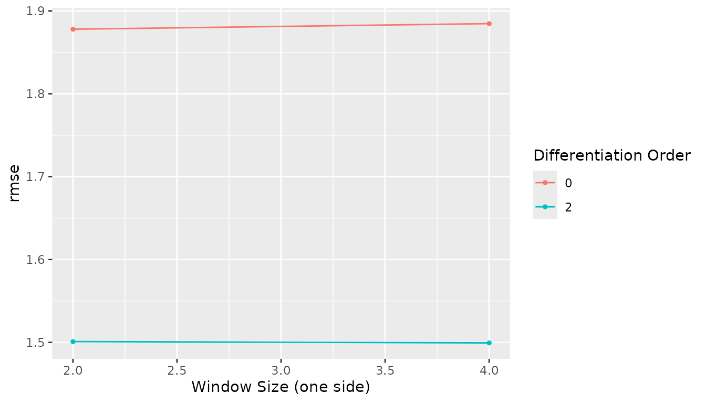
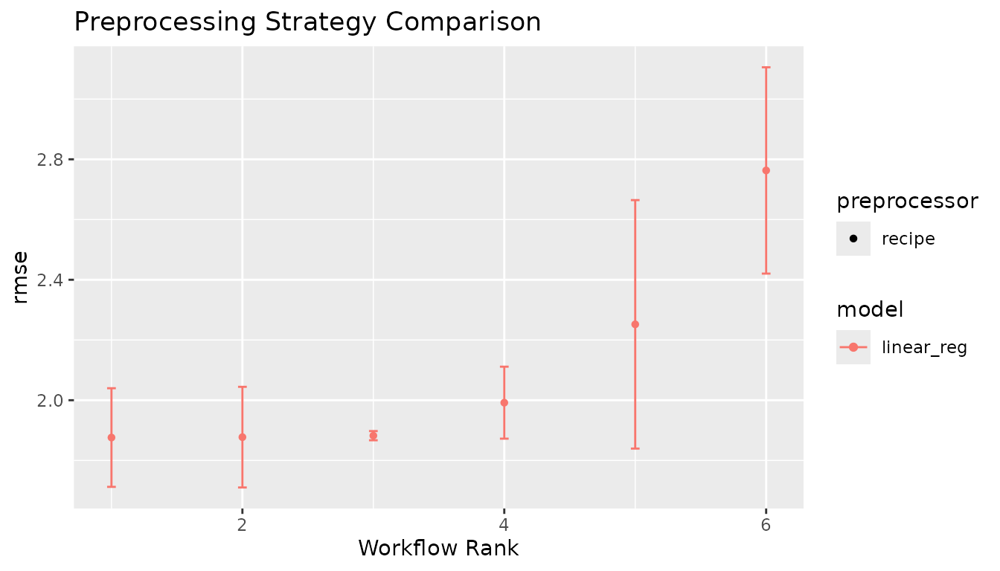

# How-To: Integrating with tidymodels

``` r

library(measure)
```

## Introduction

One of measure’s key design goals is integration with the tidymodels
ecosystem. This article shows how to use measure preprocessing in
complete modeling workflows, including:

- Bundling preprocessing with models using workflows
- Cross-validation with measure recipes
- Hyperparameter tuning for preprocessing steps
- Comparing preprocessing strategies

## Setup: The meats dataset

We’ll use the NIR spectroscopy dataset from `modeldata` to predict water
content in meat samples. The example uses a training partition for
resampling and keeps the held-out partition for one final evaluation.

``` r

data("meats", package = "modeldata")

meats_water <- dplyr::select(meats, water, dplyr::starts_with("x_")) |>
  dplyr::mutate(sample_id = dplyr::row_number())

set.seed(42)
split <- rsample::initial_split(meats_water, prop = 0.75, strata = water)
train <- rsample::training(split)

cat("Training samples:", nrow(train), "\n")
#> Training samples: 159
```

The dataset has no sample identifier, so `sample_id` gives each spectrum
a unique key. The recipe marks it as an ID rather than a predictor. This
also lets
[`step_measure_output_wide()`](https://jameshwade.github.io/measure/dev/reference/step_measure_output_wide.md)
restore one row per sample when spectral measurements are converted back
to ordinary columns.

``` r

make_measure_recipe <- function(data) {
  recipes::recipe(water ~ ., data = data) |>
    recipes::update_role(sample_id, new_role = "id") |>
    measure::step_measure_input_wide(tidyselect::starts_with("x_"))
}

set.seed(42)
folds <- rsample::vfold_cv(train, v = 3, strata = water)
```

## Basic workflow

The recipe below converts the 100 wavelength columns to measure’s
internal format, preprocesses each spectrum, converts the result back to
numeric columns, and reduces those columns to five principal components.
[`step_pca()`](https://recipes.tidymodels.org/reference/step_pca.html)
is an ordinary `recipes` step, so it follows
[`step_measure_output_wide()`](https://jameshwade.github.io/measure/dev/reference/step_measure_output_wide.md).

``` r

rec <- make_measure_recipe(train) |>
  measure::step_measure_savitzky_golay(
    window_side = 3,
    differentiation_order = 1,
    degree = 2
  ) |>
  measure::step_measure_snv() |>
  measure::step_measure_output_wide() |>
  recipes::step_pca(recipes::all_predictors(), num_comp = 5)

lm_spec <- parsnip::linear_reg() |>
  parsnip::set_engine("lm")

wf <- workflows::workflow() |>
  workflows::add_recipe(rec) |>
  workflows::add_model(lm_spec)

wf
#> ══ Workflow ════════════════════════════════════════════════════════════════════
#> Preprocessor: Recipe
#> Model: linear_reg()
#> 
#> ── Preprocessor ────────────────────────────────────────────────────────────────
#> 5 Recipe Steps
#> 
#> • step_measure_input_wide()
#> • step_measure_savitzky_golay()
#> • step_measure_snv()
#> • step_measure_output_wide()
#> • step_pca()
#> 
#> ── Model ───────────────────────────────────────────────────────────────────────
#> Linear Regression Model Specification (regression)
#> 
#> Computational engine: lm
```

### Fit and evaluate with resampling

Assess the workflow on the training partition first. `fit_resamples()`
fits the recipe using each fold’s analysis rows and applies it to that
fold’s assessment rows.

``` r

metrics <- yardstick::metric_set(yardstick::rmse, yardstick::rsq)
baseline_resamples <- tune::fit_resamples(
  wf,
  resamples = folds,
  metrics = metrics
)
baseline_metrics <- tune::collect_metrics(baseline_resamples)
stopifnot(all(baseline_metrics$n == nrow(folds)))
baseline_metrics
#> # A tibble: 2 × 6
#>   .metric .estimator  mean     n std_err .config        
#>   <chr>   <chr>      <dbl> <int>   <dbl> <chr>          
#> 1 rmse    standard   1.88      3 0.00930 pre0_mod0_post0
#> 2 rsq     standard   0.965     3 0.00292 pre0_mod0_post0
```

## Cross-validation

`folds` contains three resamples made only from the training partition.
The recipe stays inside the workflow so data-dependent preprocessing is
estimated within each analysis fold.

``` r

folds
#> #  3-fold cross-validation using stratification 
#> # A tibble: 3 × 2
#>   splits           id   
#>   <list>           <chr>
#> 1 <split [104/55]> Fold1
#> 2 <split [107/52]> Fold2
#> 3 <split [107/52]> Fold3
```

## Tuning preprocessing parameters

The Savitzky-Golay step exposes `window_side`, `differentiation_order`,
and `degree` for tuning. This example tunes window size and derivative
order while fixing the polynomial degree at 2. A four-row grid and three
folds keep the demonstration compact.

``` r

sg_parameters <- tune::tunable(
  make_measure_recipe(train) |>
    measure::step_measure_savitzky_golay()
) |>
  dplyr::select(name, component)
stopifnot(
  setequal(
    sg_parameters$name,
    c("window_side", "differentiation_order", "degree")
  )
)
sg_parameters
#> # A tibble: 3 × 2
#>   name                  component                  
#>   <chr>                 <chr>                      
#> 1 window_side           step_measure_savitzky_golay
#> 2 differentiation_order step_measure_savitzky_golay
#> 3 degree                step_measure_savitzky_golay

rec_tune <- make_measure_recipe(train) |>
  measure::step_measure_savitzky_golay(
    window_side = tune::tune("window_side"),
    differentiation_order = tune::tune("differentiation_order"),
    degree = 2
  ) |>
  measure::step_measure_snv() |>
  measure::step_measure_output_wide() |>
  recipes::step_pca(recipes::all_predictors(), num_comp = 5)

wf_tune <- workflows::workflow() |>
  workflows::add_recipe(rec_tune) |>
  workflows::add_model(lm_spec)

parameter_set <- tune::extract_parameter_set_dials(wf_tune)
stopifnot(
  setequal(parameter_set$name, c("window_side", "differentiation_order"))
)
parameter_set
#> Collection of 2 parameters for tuning
#> 
#>             identifier                  type    object
#>            window_side           window_side nparam[+]
#>  differentiation_order differentiation_order nparam[+]
#> 
```

### Define the parameter grid

The selected ranges keep every combination valid with `degree = 2`: the
differentiation order is no greater than the polynomial degree, and the
window is wider than the polynomial degree.

``` r

parameter_set$object[[match("window_side", parameter_set$id)]] <-
  measure::window_side(range = c(2L, 4L))
parameter_set$object[[match("differentiation_order", parameter_set$id)]] <-
  measure::differentiation_order(range = c(0L, 2L))

grid <- dials::grid_regular(parameter_set, levels = 2)
stopifnot(nrow(grid) == 4L)
grid
#> # A tibble: 4 × 2
#>   window_side differentiation_order
#>         <int>                 <int>
#> 1           2                     0
#> 2           4                     0
#> 3           2                     2
#> 4           4                     2
```

### Run the tuning

Each of the four parameter combinations is evaluated on the same three
training folds. The returned table shows the measured resampling
performance.

``` r

tune_results <- tune::tune_grid(
  wf_tune,
  resamples = folds,
  grid = grid,
  metrics = metrics
)
tuning_metrics <- tune::collect_metrics(tune_results)
stopifnot(all(tuning_metrics$n == nrow(folds)))

tune::show_best(tune_results, metric = "rmse", n = 4)
#> # A tibble: 4 × 8
#>   window_side differentiation_order .metric .estimator  mean     n std_err
#>         <int>                 <int> <chr>   <chr>      <dbl> <int>   <dbl>
#> 1           4                     2 rmse    standard    1.50     3  0.0294
#> 2           2                     2 rmse    standard    1.50     3  0.0465
#> 3           2                     0 rmse    standard    1.88     3  0.100 
#> 4           4                     0 rmse    standard    1.88     3  0.0986
#> # ℹ 1 more variable: .config <chr>
```

### Visualize tuning results

``` r

tune::autoplot(tune_results, metric = "rmse")
```



## Comparing preprocessing strategies

This comparison keeps the model and the number of principal components
fixed while changing spectral preprocessing. Every recipe is evaluated
on the training folds; no test-set metric is used to rank these
strategies.

``` r

rec_snv <- make_measure_recipe(train) |>
  measure::step_measure_snv() |>
  measure::step_measure_output_wide() |>
  recipes::step_pca(recipes::all_predictors(), num_comp = 5)

rec_d1_snv <- make_measure_recipe(train) |>
  measure::step_measure_savitzky_golay(
    window_side = 3,
    differentiation_order = 1,
    degree = 2
  ) |>
  measure::step_measure_snv() |>
  measure::step_measure_output_wide() |>
  recipes::step_pca(recipes::all_predictors(), num_comp = 5)

rec_msc <- make_measure_recipe(train) |>
  measure::step_measure_msc() |>
  measure::step_measure_output_wide() |>
  recipes::step_pca(recipes::all_predictors(), num_comp = 5)

rec_d2 <- make_measure_recipe(train) |>
  measure::step_measure_savitzky_golay(
    window_side = 3,
    differentiation_order = 2,
    degree = 2
  ) |>
  measure::step_measure_output_wide() |>
  recipes::step_pca(recipes::all_predictors(), num_comp = 5)

rec_snv_center <- make_measure_recipe(train) |>
  measure::step_measure_snv() |>
  measure::step_measure_center() |>
  measure::step_measure_output_wide() |>
  recipes::step_pca(recipes::all_predictors(), num_comp = 5)

rec_norm_scale <- make_measure_recipe(train) |>
  measure::step_measure_normalize_sum() |>
  measure::step_measure_scale_auto() |>
  measure::step_measure_output_wide() |>
  recipes::step_pca(recipes::all_predictors(), num_comp = 5)

wf_set <- workflowsets::workflow_set(
  preproc = list(
    snv = rec_snv,
    d1_snv = rec_d1_snv,
    msc = rec_msc,
    d2 = rec_d2,
    snv_center = rec_snv_center,
    norm_scale = rec_norm_scale
  ),
  models = list(lm = lm_spec)
)

wf_set
#> # A workflow set/tibble: 6 × 4
#>   wflow_id      info             option    result    
#>   <chr>         <list>           <list>    <list>    
#> 1 snv_lm        <tibble [1 × 4]> <opts[0]> <list [0]>
#> 2 d1_snv_lm     <tibble [1 × 4]> <opts[0]> <list [0]>
#> 3 msc_lm        <tibble [1 × 4]> <opts[0]> <list [0]>
#> 4 d2_lm         <tibble [1 × 4]> <opts[0]> <list [0]>
#> 5 snv_center_lm <tibble [1 × 4]> <opts[0]> <list [0]>
#> 6 norm_scale_lm <tibble [1 × 4]> <opts[0]> <list [0]>
```

### Evaluate all strategies

``` r

comparison <- workflowsets::workflow_map(
  wf_set,
  fn = "fit_resamples",
  resamples = folds,
  metrics = metrics
)

strategy_results <- workflowsets::rank_results(comparison, rank_metric = "rmse") |>
  dplyr::filter(.metric == "rmse")
stopifnot(
  nrow(strategy_results) == 6L,
  all(strategy_results$n == nrow(folds))
)
strategy_results
#> # A tibble: 6 × 9
#>   wflow_id      .config     .metric  mean std_err     n preprocessor model  rank
#>   <chr>         <chr>       <chr>   <dbl>   <dbl> <int> <chr>        <chr> <int>
#> 1 snv_center_lm pre0_mod0_… rmse     1.88 0.0996      3 recipe       line…     1
#> 2 snv_lm        pre0_mod0_… rmse     1.88 0.102       3 recipe       line…     2
#> 3 d1_snv_lm     pre0_mod0_… rmse     1.88 0.00930     3 recipe       line…     3
#> 4 msc_lm        pre0_mod0_… rmse     1.99 0.0727      3 recipe       line…     4
#> 5 norm_scale_lm pre0_mod0_… rmse     2.25 0.251       3 recipe       line…     5
#> 6 d2_lm         pre0_mod0_… rmse     2.76 0.208       3 recipe       line…     6
```

### Visualize comparison

``` r

workflowsets::autoplot(comparison, metric = "rmse") +
  ggplot2::labs(title = "Preprocessing Strategy Comparison")
```



## Finalize and evaluate on the held-out set

Use the training resamples to choose the tuning values, then evaluate
the finalized workflow on the reserved test partition once with
`last_fit()`.

``` r

best_params <- tune::select_best(tune_results, metric = "rmse")
best_params
#> # A tibble: 1 × 3
#>   window_side differentiation_order .config        
#>         <int>                 <int> <chr>          
#> 1           4                     2 pre4_mod0_post0

final_wf <- tune::finalize_workflow(wf_tune, best_params)
final_fit <- tune::last_fit(final_wf, split, metrics = metrics)
final_metrics <- tune::collect_metrics(final_fit)
stopifnot(nrow(final_metrics) > 0L)
final_metrics
#> # A tibble: 2 × 4
#>   .metric .estimator .estimate .config        
#>   <chr>   <chr>          <dbl> <chr>          
#> 1 rmse    standard       1.37  pre0_mod0_post0
#> 2 rsq     standard       0.978 pre0_mod0_post0
```

## Working with workflows and new data

`last_fit()` retains a workflow fitted on the training partition. After
the final evaluation, it can be extracted and used to predict new
spectra. The example below uses only the held-out predictors to
demonstrate prediction; it does not feed predictions back into model
selection.

``` r

final_trained <- tune::extract_workflow(final_fit)
new_spectra <- rsample::testing(split) |>
  dplyr::select(sample_id, dplyr::starts_with("x_")) |>
  dplyr::slice_head(n = 3)

new_predictions <- stats::predict(final_trained, new_data = new_spectra)
dplyr::bind_cols(
  dplyr::select(new_spectra, sample_id),
  new_predictions
)
#> # A tibble: 3 × 2
#>   sample_id .pred
#>       <int> <dbl>
#> 1         1  59.0
#> 2         8  67.9
#> 3        14  72.6
```

## Tips for spectral modeling

### High-dimensional data

The `meats` training partition has about 160 samples and 100 wavelength
columns. In smaller studies, the number of wavelengths can exceed the
number of samples, and spectral predictors are often strongly
correlated. This example reduces the linear fit to five principal
components. Other options include:

1.  **Regularization**: Use ridge or elastic net with an available
    parsnip engine, and tune its penalty within resampling.
2.  **Feature selection**: Choose a selection method that matches the
    scientific question and perform selection inside the resampling
    workflow.

### Preprocessing for PCA

[`step_pca()`](https://recipes.tidymodels.org/reference/step_pca.html)
expects ordinary numeric columns, so place it after
[`step_measure_output_wide()`](https://jameshwade.github.io/measure/dev/reference/step_measure_output_wide.md).
In a workflow, the PCA rotation is estimated within each analysis fold.

``` r

rec_for_pca <- make_measure_recipe(train) |>
  measure::step_measure_snv() |>
  measure::step_measure_output_wide() |>
  recipes::step_pca(recipes::all_predictors(), num_comp = 5)

rec_for_pca
#> 
#> ── Recipe ──────────────────────────────────────────────────────────────────────
#> 
#> ── Inputs
#> Number of variables by role
#> outcome:     1
#> predictor: 100
#> id:          1
#> 
#> ── Operations
#> • Collate wide analytical measurements: tidyselect::starts_with("x_")
#> SNV transformation on
#> • Restructure analytical measurements to wide format: "<internal data>"
#> • PCA extraction with: recipes::all_predictors()
```

Use
[`step_measure_scale_auto()`](https://jameshwade.github.io/measure/dev/reference/step_measure_scale_auto.md)
if you want to give equal weight to all wavelengths, or
[`step_measure_scale_pareto()`](https://jameshwade.github.io/measure/dev/reference/step_measure_scale_pareto.md)
for a compromise that preserves some magnitude information.

### Memory considerations

For very large spectral datasets:

- The internal `.measures` format is memory-efficient
- Consider processing in batches if memory is limited
- Use
  [`step_measure_output_wide()`](https://jameshwade.github.io/measure/dev/reference/step_measure_output_wide.md)
  when standard modeling steps need numeric predictor columns

### Reproducibility

Set a seed before creating resamples or random tuning grids:

``` r

set.seed(123)
reproducible_folds <- rsample::vfold_cv(train, v = 3, strata = water)
reproducible_folds
#> #  3-fold cross-validation using stratification 
#> # A tibble: 3 × 2
#>   splits           id   
#>   <list>           <chr>
#> 1 <split [104/55]> Fold1
#> 2 <split [107/52]> Fold2
#> 3 <split [107/52]> Fold3
```

## Summary

measure integrates with tidymodels workflows:

- Use workflows to bundle measure preprocessing and a model
- Use `fit_resamples()` or `tune_grid()` on the training partition
- Tune measure step parameters through the recipe interface
- Compare preprocessing strategies on the same resamples
- Use `last_fit()` for one final evaluation on a reserved test partition

Workflow resampling prepares each recipe from the analysis portion of a
fold, then applies it to that fold’s assessment portion. This keeps
learned preprocessing estimates out of assessment data in these
workflows. Steps performed before resampling can still leak information,
so keep learned preprocessing inside the resampled recipe.

## See Also

- [Getting
  Started](https://jameshwade.github.io/measure/dev/articles/tutorial-getting-started.md) -
  Learn the fundamentals of measure
- [Bioreactor Case
  Study](https://jameshwade.github.io/measure/dev/articles/tutorial-bioreactor.md) -
  Complete modeling workflow example
- [Preprocessing
  Reference](https://jameshwade.github.io/measure/dev/articles/reference-preprocessing.md) -
  Guide to all preprocessing techniques
